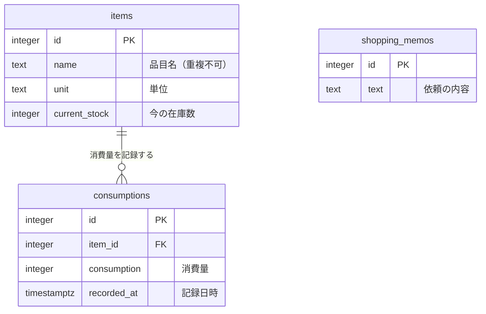

# Data and Security Design（データ・セキュリティ設計）

<!-- Document Info（文書情報） -->
| Item（項目） | Value（値） |
|---|---|
| Document ID（文書ID） | RH-DATA |
| Version（バージョン） | 0.1 |
| Status（ステータス） | Draft |
| Created Date（作成日） | 2026-10-14 |
| Last Updated（最終更新日） | 2026-10-14 |
| Owner（管理者） | SG-31 |
| Related Documents（関連文書） | [README.md](../README.md) / [02_REQUIREMENTS_DEFINITION.md](./02_REQUIREMENTS_DEFINITION.md) / [05_ARCHITECTURE_DESIGN.md](./05_ARCHITECTURE_DESIGN.md) |

---

## Table of Contents（目次）

1. [Purpose（目的）](#1-purpose目的)
2. [Scope（対象範囲）](#2-scope対象範囲)
3. [Out of Scope（対象外範囲）](#3-out-of-scope対象外範囲)
4. [Assumptions（前提条件）](#4-assumptions前提条件)
5. [Definition Details（定義内容）](#5-definition-details定義内容)
6. [Open Issues（未決事項）](#6-open-issues未決事項)
7. [Handoff to Detail Design（詳細設計への引き継ぎ）](#7-handoff-to-detail-design詳細設計への引き継ぎ)

---

## 1. Purpose（目的）

Restock Helper が扱うデータの種類・保存先・関係と、ログイン・秘密の値・データの守り方を定義する。

---

## 2. Scope（対象範囲）

- DB に保存するデータ（3つのテーブル）と、保存しないデータ
- ログイン、フォームの送信の確認、秘密の値の管理
- データの削除の扱い

---

## 3. Out of Scope（対象外範囲）

- 画面の入力チェックとエラー表示は 04、DB の置き場所と接続の上限は 05、障害のときの対応と見本データの入れ直しの手順は 06 で扱う

---

## 4. Assumptions（前提条件）

- 公開版はデモ用で、見本のデータだけを入れる。実在の人の名前・住所・連絡先は扱わない
- 1世帯専用とし、世帯ごとにデータを分ける仕組みは持たない（01 の対象外範囲）
- 共通のパスワード1つでログインし、利用者ごとのアカウントは持たない

---

## 5. Definition Details（定義内容）

### 5.1 Entity Definition and ER Diagram（エンティティ定義・ER図）

#### Entity List（エンティティ一覧）

| Entity Name（エンティティ名） | Description（説明） |
|---|---|
| items（管理品目） | 在庫を記録する日用品。今の在庫数を1件につき1つだけ持つ |
| consumptions（消費量） | 在庫を入力するたびに記録する、前回からの消費量の履歴 |
| shopping_memos（買ってほしいもの） | 高齢者が追加する、その回限りの依頼。管理品目とはつながらない |

#### ER Diagram（ER図）

### 5.2 Table Definitions（テーブル定義）

#### items（管理品目）

| Column（カラム名） | Type（型） | NOT NULL | PK / FK | Description（説明） |
|---|---|---|---|---|
| id | INTEGER | ○ | PK | 品目ID（自動で番号を振る） |
| name | TEXT | ○ | | 品目名。重複不可 |
| unit | TEXT | ○ | | 単位（本、個、ロールなど） |
| current_stock | INTEGER | ○ | | 今の在庫数。0以上。履歴は持たず、入力のたびに上書きする |
| created_at | TIMESTAMPTZ | ○ | | 登録日時 |
| updated_at | TIMESTAMPTZ | ○ | | 更新日時 |

#### consumptions（消費量）

| Column（カラム名） | Type（型） | NOT NULL | PK / FK | Description（説明） |
|---|---|---|---|---|
| id | INTEGER | ○ | PK | 消費量ID（自動で番号を振る） |
| item_id | INTEGER | ○ | FK（items.id） | どの品目の記録か。品目を削除すると、この記録も一緒に消える |
| consumption | INTEGER | ○ | | 消費量（前回の在庫数 − 今回の在庫数）。0以上。在庫が増えていた場合は0とする |
| recorded_at | TIMESTAMPTZ | ○ | | 記録日時 |

#### shopping_memos（買ってほしいもの）

| Column（カラム名） | Type（型） | NOT NULL | PK / FK | Description（説明） |
|---|---|---|---|---|
| id | INTEGER | ○ | PK | メモID（自動で番号を振る） |
| text | TEXT | ○ | | 依頼の内容（100文字以内） |
| created_at | TIMESTAMPTZ | ○ | | 追加日時 |

#### 決めごと

- **保存しないもの**：消費量の平均、適正在庫数、補充する数、買い物リストそのもの。必要なときに、保存したデータから毎回計算する（保存しなくても同じ値が求まり、食い違いが起きないため）
- **DB でも守るルール**：在庫数と消費量は0以上、品目名は重複不可。画面とサーバーの入力チェックに加えて、DB でも二重に守る
- **日時**はタイムゾーン付きで保存する。開発用の PC と本番で、時刻の基準がずれないようにするため
- **在庫数を直接直したとき**（SCR-005 の変更）は、消費量を記録しない。数え間違いの訂正や、買わなかった品目の補正に使うため

### 5.3 Data Access and Role Design（データアクセス権限・ロール設計）

| Role Name（ロール名） | Accessible Data / Permitted Operations（アクセス可能なデータ / 操作範囲） |
|---|---|
| 高齢者（SCR-002 を使う） | ・補充が必要な品目を見る ・買ってほしいものを追加・削除する |
| ヘルパー（SCR-003〜005 を使う） | ・品目の登録・変更・削除 ・在庫数の入力（消費量の記録） ・買い物完了（在庫数への加算と、買ってほしいものの全削除） ・買い物の間は SCR-002 も見る |

- 役割は**使う画面で分けている**だけで、システムが利用者を見分けて操作を制限することはしない。ログインした人は、すべての画面を使える
- 理由：利用者は世帯の2人だけで、共通のパスワードで入口を守れば足りるため

### 5.4 Personal and Confidential Data Policy（個人情報・機密データの取り扱い方針）

- **個人情報**：対象外。理由：名前・住所・連絡先などは保存しない。保存するのは品目名・数量・依頼の内容だけで、公開版は見本のデータだけを入れるため
- **機密データ**：ログインのパスワード、セッションの署名に使う鍵（`SECRET_KEY`）、DB の接続先。いずれも DB には保存せず、環境変数に置く（5.6）

### 5.5 Encryption, Masking, and Logging Policy（暗号化・マスキング・ログ取得方針）

| Type（種別） | Target（対象） | Policy / Method（方式・方針） |
|---|---|---|
| Encryption（暗号化） | ・利用者とアプリの通信 ・アプリと DB の通信 | ・本番は Vercel の HTTPS で通信する ・アプリと Neon の間は、接続先の設定で暗号化を必須にする（Neon が示す接続先のとおり） |
| Masking（マスキング） | ・パスワード ・DB の接続先 | ・画面・ログ・チャット・コマンドの行に出さない ・見本データのスクリプトは、接続先のうちホスト名と DB 名だけを表示し、パスワードは表示しない |
| Logging（ログ取得） | ・エラーの内容 | ・エラーの詳細はサーバーのログ（本番は Vercel の Logs）にだけ残し、画面には決まったメッセージだけを出す ・ログに個人情報は含まれない（5.4） ・保管期間は Vercel の設定に従う |

### 5.6 Security Design Specifications（セキュリティ設計仕様）

| Type（種別） | Design Specification（設計仕様） |
|---|---|
| Authentication（認証） | ・共通のパスワード1つでログインする（環境変数 `APP_PASSWORD`） ・比べるときは、前後の空白を除き、時間の差で中身を推測されにくい方法で比べる ・ログイン状態は30日保つ。ログイン後の移動先は常にトップ画面（外部のサイトへ飛ばされる弱点を作らないため） ・ログアウトは POST の操作で行う ・パスワードの再設定・利用者ごとのアカウント・**間違えたときの回数制限は作らない**。理由：デモ用で見本のデータだけのため。本物のデータを扱う版を作るときに見直す |
| Authorization（認可） | ・ログインしていれば、すべての画面と操作を使える（5.3） |
| Access Control（権限管理） | ・ログインの確認は、各画面ではなく1か所でまとめて行う。ログイン画面と CSS 以外は、未ログインならログイン画面に移す ・不正なフォーム送信を防ぐため、データを変える操作はすべて POST で行い、送信のたびに確認用の値（CSRF トークン）を照合する ・CSRF トークンの有効期限は設けない。理由：在庫を数えている間に期限が切れ、入力が無駄になるのを防ぐため。トークンはブラウザのセッションに結びつくため、単体で盗まれても使える範囲は限られる |
| Communication（通信） | ・本番は HTTPS ・ログイン状態の Cookie は、JavaScript から読めない設定、本番では HTTPS でしか送らない設定、ほかのサイトからの送信に付かない設定（Lax）とする |
| Data Storage（データ保存） | ・データは Neon の PostgreSQL に保存する（05） ・秘密の値（`DATABASE_URL`・`SECRET_KEY`・`APP_PASSWORD`）は環境変数に置き、ローカルは `.env`、本番は Vercel の環境変数とする。`.env` は Git に入れない ・秘密の値は環境ごとに別の値にする。`SECRET_KEY` は乱数で作った値を使う ・秘密の値が設定されていないときは、アプリを起動しない ・SQL はプレースホルダを使い、入力値を文字列としてつなげない |
| Data Disposal（データ廃棄） | ・品目を削除すると、その品目の消費量も一緒に完全に消える（確認の警告を出してから行う） ・買い物完了で、買ってほしいものをすべて消す ・見本データの入れ直しでは、3つのテーブルを空にしてから入れる |
| Personal Data Protection（個人情報保護） | 対象外。理由：個人情報を扱わないため（5.4） |

#### 知っておく制約

- ログイン状態はサーバーに保存せず、署名付きの Cookie としてブラウザに渡す。そのため、ログアウトしても、それより前に写し取られた Cookie は期限（30日）まで使える。漏れたおそれがあるときは `SECRET_KEY` を変えると、全員のログイン状態を無効にできる（06 の 5.5）
- `APP_PASSWORD` を変えても、すでにログインしている人はログアウトされない

---

## 6. Open Issues（未決事項）

現時点で未決事項はない。

---

## 7. Handoff to Detail Design（詳細設計への引き継ぎ）

- **データを変える操作は、必ず POST にする**：GET でデータを変えると、CSRF 対策が働かないため
- **計算で求められる値は、DB に保存しない**：保存した値と計算結果が食い違う原因になるため
- **本物のデータを扱う版を作るときは、認証を見直す**：パスワードの強さ、間違えたときの回数制限、世帯ごとのデータの分け方を検討する
