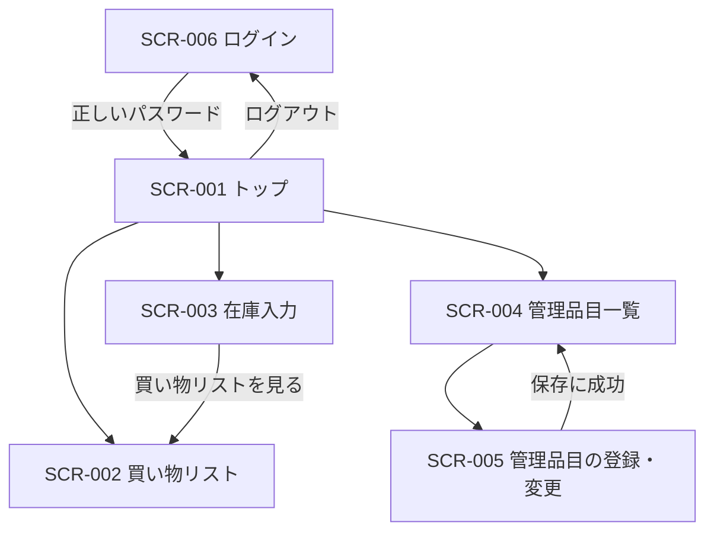

# UI and Flow Design（UI・フロー設計）

<!-- Document Info（文書情報） -->
| Item（項目） | Value（値） |
|---|---|
| Document ID（文書ID） | RH-UI |
| Version（バージョン） | 0.1 |
| Status（ステータス） | Draft |
| Created Date（作成日） | 2026-10-14 |
| Last Updated（最終更新日） | 2026-10-14 |
| Owner（管理者） | SG-31 |
| Related Documents（関連文書） | [README.md](../README.md) / [02_REQUIREMENTS_DEFINITION.md](./02_REQUIREMENTS_DEFINITION.md) / [05_ARCHITECTURE_DESIGN.md](./05_ARCHITECTURE_DESIGN.md) |

---

## Table of Contents（目次）

1. [Purpose（目的）](#1-purpose目的)
2. [Scope（対象範囲）](#2-scope対象範囲)
3. [Out of Scope（対象外範囲）](#3-out-of-scope対象外範囲)
4. [Assumptions（前提条件）](#4-assumptions前提条件)
5. [Definition Details（定義内容）](#5-definition-details定義内容)
6. [Open Issues（未決事項）](#6-open-issues未決事項)
7. [Handoff to Detail Design（詳細設計への引き継ぎ）](#7-handoff-to-detail-design詳細設計への引き継ぎ)

---

## 1. Purpose（目的）

02 の画面一覧（SCR-001〜006）について、各画面の項目・操作、画面の移り方、入力チェックとエラーの表示を定義する。

---

## 2. Scope（対象範囲）

02 の画面一覧の6画面と、その間の移動、入力チェック・エラー表示、スマートフォンでの表示。

---

## 3. Out of Scope（対象外範囲）

- 作らない機能は 02 の対象外範囲のとおり
- データの守り方・ログインの仕組みは 03、技術構成は 05、確認の方法は 06 で扱う

---

## 4. Assumptions（前提条件）

- 利用者はスマートフォンのブラウザで使う。トップ画面をホーム画面に追加して開く想定とする
- 高齢者とヘルパーの役割は、使う画面（URL）で分ける。システムが利用者を見分けて操作を制限することはしない
- ログインしていない状態でどの画面を開いても、ログイン画面に移る

---

## 5. Definition Details（定義内容）

### 5.1 Screen List — Detail Definition（画面一覧・詳細定義）

| Screen ID（画面ID） | Screen Name（画面名） | Input Items（入力項目） | Output Items（出力項目） | Main Operations（主要操作） | Notes（備考） |
|---|---|---|---|---|---|
| SCR-001 | トップ | なし | ・買い物リストへのリンク<br>・在庫入力へのリンク<br>・管理品目一覧へのリンク | ・各画面へ移動<br>・ログアウト | ・在庫入力へのリンクは「在庫を入力する（買い物完了もこちら）」と表示する |
| SCR-002 | 買い物リスト（高齢者用） | ・買ってほしいもの（自由な文） | ・補充が必要なもの（品目名、補充する数、単位）<br>・買ってほしいものの一覧<br>・入力エラーのメッセージ | ・買ってほしいものの追加<br>・買ってほしいものの削除 | ・在庫入力へのリンクは置かない（高齢者用の画面のため） |
| SCR-003 | 在庫入力（ヘルパー用） | ・品目ごとの在庫数 | ・品目の一覧（品目名、単位。今の在庫数は入力欄に薄く表示）<br>・買い物リスト（品目名、補充する数）<br>・結果の通知・警告 | ・在庫保存<br>・買い物リストへ移動<br>・買い物完了 | ・在庫保存・買い物完了の後も同じ画面にとどまり、更新後の内容と結果の通知を表示する |
| SCR-004 | 管理品目一覧 | なし | ・登録済みの品目（品目名、単位、今の在庫数）<br>・結果の通知 | ・登録画面へ移動<br>・行ごとの変更<br>・行ごとの削除 | ・削除は確認の警告を出してから行う |
| SCR-005 | 管理品目の登録・変更 | ・品目名<br>・単位<br>・在庫数 | ・入力エラーのメッセージ | ・登録／変更の保存 | ・登録と変更で同じ画面を使う<br>・在庫数の見出しは、登録では「初期在庫数」とする |
| SCR-006 | ログイン | ・共通パスワード | ・結果のメッセージ | ・ログイン | ・ログイン後は常にトップ画面に移る<br>・ログイン済みで開いた場合も、トップ画面に移る |

### 5.2 Screen Transition and Business Flow（画面遷移図・業務フロー）

#### 画面遷移



- SCR-002〜005 には、トップ画面へ戻るリンクを置く
- 未ログインのときは、どの画面を開いても SCR-006 に移る
- 存在しない画面や品目を開いたときは、トップ画面へ戻るリンクのある「画面が見つかりませんでした。」の画面を出す

#### 1週間の業務の流れ

1. ヘルパーが訪問し、SCR-003 で在庫数を入力して保存する → 同じ画面に買い物リストが出る
2. 高齢者は SCR-002 でリストを見て、「買ってほしいもの」を追加する
3. ヘルパーは SCR-003 から SCR-002 に移り、リストと「買ってほしいもの」を見ながら店で買う
4. 戻ったら SCR-003 で「買い物完了」を押す → 在庫数に補充分が足され、「買ってほしいもの」が消える

### 5.3 Wireframes and Layout Policy（主要画面のワイヤーフレーム・レイアウト方針）

#### SCR-002 買い物リスト（高齢者用）

```text
買い物リスト
トップに戻る
▌補充が必要なもの
  ・トイレットペーパー　3 ロール
  ・牛乳　3 本
▌買ってほしいもの
  ・単3電池 4本　［削除］
  ・のど飴　　　 ［削除］
▌買ってほしいものを追加
  [ 入力欄 ]［追加］
```

- 高齢者が見る画面のため、読みやすさの調整はこの画面に集中させる
- 見出しと内容の文字の大きさの差は小さくし、区別は太さ・薄い背景色・左の線でつける
- 余白を十分に取り、情報を詰め込まない
- スペースのない長い英数字も、画面の幅の中で折り返す
- 補充が必要な品目がないときは「補充が必要なものはありません」と表示する

#### SCR-003 在庫入力（ヘルパー用）

```text
在庫入力
トップに戻る
在庫を更新しました。　　　　　　　　　　　 ← 保存・完了の後に出る通知
| 品目名           | 単位   | 現在庫数        |
| トイレットペーパー | ロール | [ 空欄（参考：3）] | ← 値を変えた行は背景色が変わる
| 牛乳             | 本     | [ 空欄（参考：1）] |
［在庫保存］
買い物リスト（買い物リストを見る）
| 品目名           | 補充必要数 |
| トイレットペーパー | 3 ロール   |
［買い物完了］
```

- 入力欄は空欄で始め、今の在庫数は参考として薄く表示する（未確認のまま保存して「消費量0」が記録されるのを防ぐため）
- 「買い物リスト」の見出しと「買い物完了」ボタンは常に表示する。補充が必要な品目がない週も、「買ってほしいもの」を消すために完了操作が要るため。そのときは「補充が必要なものはありません。」と表示する

#### SCR-001・004・005・006

ブラウザの標準の表示とする。ヘルパーが使う画面で、表と入力欄が並ぶだけのため。

### 5.4 Operation Flow and User Scenarios（操作フロー・ユーザーシナリオ）

| Scenario ID（シナリオID） | Operation Name（操作名） | Steps（操作手順） |
|---|---|---|
| SN-001 | 在庫を入力する | 1. SCR-003 を開く → 2. 数えた品目の在庫数を入力する（数えていない品目は空欄のまま） → 3. 「在庫保存」→ 確認ダイアログ「今週分として更新しますが、よいですか？」で OK → 4. 画面が更新され、「在庫を更新しました。」と新しい在庫数・買い物リストが出る（何も入力していなかった場合は「更新された品目はありませんでした。」） |
| SN-002 | 買ってほしいものを頼む | 1. SCR-002 を開く → 2. 入力欄に書いて「追加」 → 3. 一覧に出る（不要になったら「削除」） |
| SN-003 | 買い物を完了する | 1. 買い物の後、SCR-003 を開く → 2. 「買い物完了」→ 確認ダイアログ「今週分として更新します。「買ってほしいもの」の一覧も消えますが、よいですか？」で OK → 3. 画面が更新され、「買い物が完了しました。」と、補充分が足された在庫数、「補充が必要なものはありません。」が出る |
| SN-004 | 品目を登録・変更する | 1. SCR-004 から SCR-005 を開く → 2. 品目名・単位・在庫数を入力して保存 → 3. 成功すると SCR-004 に戻り、「管理品目を登録しました。」または「管理品目を変更しました。」が出る |
| SN-005 | 品目を削除する | 1. SCR-004 で「削除」 → 2. 警告「削除すると、この品目の過去の消費量データも消えます。よろしいですか？」を確認して OK → 3. 一覧から消える |
| SN-006 | ログイン・ログアウト | 1. SCR-006 で共通パスワードを入力 → 2. トップ画面に移る（30日保つ。この間に SCR-006 を開いても、トップ画面に移る） → 3. トップ画面の「ログアウト」で SCR-006 に戻り、「ログアウトしました。」が出る |

### 5.5 Validation and Error Handling Policy（バリデーション・エラーハンドリング方針 / UI層）

入力チェックは、ブラウザの入力欄の制限に加えて、必ずサーバー側でも行う（ブラウザの制限は外せるため）。

#### 入力チェック

| Target（対象） | Validation Rules（バリデーションルール） | Error Message / Display Policy（エラーメッセージ・表示方針） |
|---|---|---|
| 在庫数（SCR-003） | 0以上9999以下の整数。空欄の品目は保存しない（前回の値を保つ） | 誤った品目だけ「品目名：メッセージ」の形で警告し、保存しない。正しく入力した品目は保存する |
| 在庫数（SCR-005） | 0以上9999以下の整数 | メッセージを表示して保存せず、入力した内容を残す |
| 品目名（SCR-005） | 必須。前後の空白を除く。100文字以内。登録済みの品目名と重複しない | 「同じ品目名がすでに登録されています。」などを表示し、入力した内容を残す |
| 単位（SCR-005） | 必須。100文字以内 | 同上 |
| 買ってほしいもの（SCR-002） | 空欄・空白のみは保存しない。100文字以内 | 空欄は何も表示しない。101文字以上は「買ってほしいものは100文字以内で入力してください。」 |
| パスワード（SCR-006） | 前後の空白を除いて比べる（貼り付けやスマートフォンの入力で空白が入るため） | 「パスワードが違います。」を表示し、入力欄を空にする |

#### エラー表示

エラーの内容（DBの名前や英語のエラーの文）は画面に出さず、サーバーのログにだけ残す。

| Target（対象） | Condition（条件） | Error Message / Display Policy（エラーメッセージ・表示方針） |
|---|---|---|
| 画面を開くときの読み込み（SCR-002〜005） | DBからデータを読み込めない | 「データを読み込めませんでした。時間をおいて開き直してください。」を表示する。空の一覧や「〜はありません」は出さない（「データが消えた」と誤解させないため）。SCR-005 では入力欄も出さない |
| 保存・削除などの操作（SCR-002〜005） | DBへの書き込みに失敗する | 「（操作名）できませんでした。しばらくしてから、もう一度お試しください。」を表示する。SCR-005 では入力した内容を残す |
| 存在しない画面・品目（全画面） | URLや品目が見つからない | 「画面が見つかりませんでした。」とトップへ戻るリンクの画面を出す |
| フォームの送信確認（全画面） | 不正なフォーム送信を防ぐ確認（CSRF対策。03）に通らない | 「画面の有効期限が切れたか、送信内容を確認できませんでした。画面を開き直してから、もう一度操作してください。」とトップへ戻るリンクの画面を出す |

#### 誤操作・二重送信を防ぐ表示

- 在庫保存・買い物完了・品目削除の前に、確認ダイアログを1回出す
- 在庫保存は、確認で OK した後にボタンを押せなくし、「保存中...」と表示する
- データを変える操作の後は、結果の画面へ移し直す（再読み込みで同じ操作が送られないようにする）
- ブラウザの戻るボタンでは、操作は取り消せない。間違えた場合は SCR-005 で直す（直し方は 06）

### 5.6 Accessibility and Responsive Design Policy（アクセシビリティ・レスポンシブ対応方針）

- 全画面に、スマートフォンの画面幅に合わせて表示する設定を入れる
- アクセシビリティの公的な基準への準拠は対象外とする。理由：個人で作るデモ用アプリのため。代わりに、高齢者が見る SCR-002 で読みやすさを確保する（5.3）

---

## 6. Open Issues（未決事項）

現時点で未決事項はない。

---

## 7. Handoff to Detail Design（詳細設計への引き継ぎ）

- **画面に何を出すかは、通知の有無ではなく、その時点のデータで決める**：保存後の通知は一度出ると消える。買い物リストのように「今の事実」を表す部分は、画面を開くたびにデータから計算し直す。通知の有無で表示を切り替えると、別の画面を経由して戻ったときに表示が消える（実際に起きた不具合）
- **役割を画面で分ける方針を崩さない**：高齢者用の SCR-002 に、ヘルパー向けの操作や説明を入れない
- **確認ダイアログは、取り消しにくい操作に限る**：在庫保存・買い物完了・品目削除の3つ
